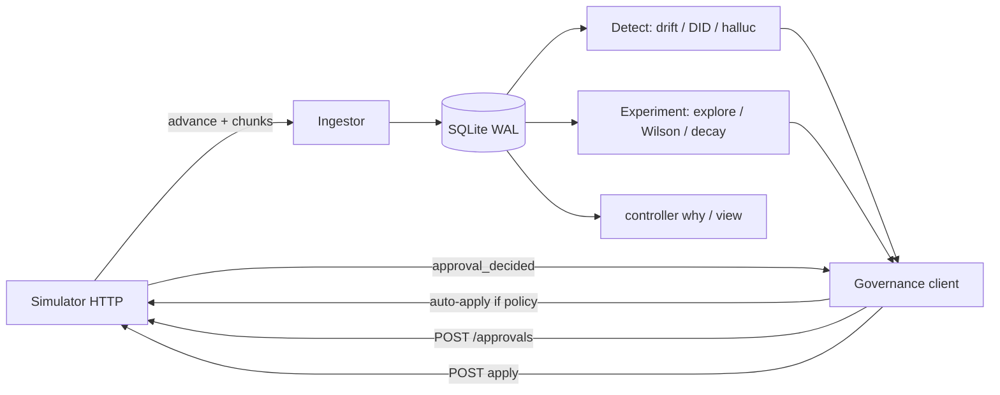

# Outcome-First Agent Loop — Submission

**Name:** Abhyuday · **Date:** 2026-11-10 · **Hours actually spent (be honest):** ~14 · **Language / storage:** Python 3.11 + SQLite (stdlib)

> Copy of `SUBMISSION_TEMPLATE.md` headings preserved.

---

## 0. TL;DR

A crash-safe controller ingests simulator events into SQLite, forms one shared cohort object per workflow, explores welcome×voice with statistical promotion, rotates unhealthy caller IDs, learns call-time weights, and routes prompt incidents through LLM→validation→approval. It never blends pickup/engagement, never lets the LLM pick winners, and never silently overwrites supervisor edits. Floor (public_01/02 end-to-end + audit) is met; deliberately cut: fair multi-tenant credit markets (C15), rich UI (C11 partial via CLI), and deep per-person bandit call-time (C4 partial).

## 1. Assumptions

1. History chunks before D0 are trustworthy enough to bootstrap cohorts and hour priors.
2. Approver `base_reject_rate` is irreducible noise — retry next decision window with fresh evidence, never resubmit the same expired proposal_id.
3. Hallucination flags are noisy; we require a population rate ≥ 2.5% on ≥ 40 connected calls before spending credits.
4. Independent sampling of welcome/voice/caller_id in the sim means we can explore dimensions separately (interaction effects exist but full factorial is too fragmenting for the time budget).
5. `mid_flight: next_campaign_only` means agent-facing allocation wins accrue on the next campaign — we still propose promptly.
6. Evaluation box has Python + pip; no Docker required (though Docker would work unchanged).
7. Sales’ claim that “Northwind KYC has auto-apply” is false unless the workflow policy says so — we trust `GET /workflows/{id}`.
8. A single SQLite file per run is enough state for the envelope if writes are batched; Postgres would be the production swap without changing the loop shape.

## 2. Scope decisions

| # | Capability | Built / Partial / Cut | Why | What it would take to finish |
|---|---|---|---|---|
| C1 | Event ingestion at load scale | Built | Non-negotiable for C13/C14 and public_03 | Partitioned DBs per tenant at 10× |
| C2 | Shared cohort object | Built | Product + learning loop both require it | Adaptive cohort splits with hierarchical pooling |
| C3 | Bootstrapping from history | Built | Free signal before D0 | Empirical Bayes priors per variant |
| C4 | Call-time optimisation | Partial | High lift, schedule often auto-applicable | Full contextual bandit + cold-start policy |
| C5 | Caller-ID health | Built | public_02 incident + clear KPI | Thompson sampling over DID health |
| C6 | Variant experimentation | Built | Core outcome lever | Sequential testing with alpha spending |
| C7 | Promote / decay / rollback | Built | Graded explicitly | CUSUM / EWMA decay detectors |
| C8 | Hallucination incident response | Built | public_02 supervisor bad prompt | Credit-aware multi-tenant budgeter |
| C9 | Governance client | Built | Constraint #1 | Smarter batching across dims by impact |
| C10 | Impact / dry run / affected leads | Built | Approval quality | Offline replay simulator |
| C11 | Supervisor view | Partial | Ops asked; CLI `controller view` | Small read-only HTTP UI |
| C12 | Audit store | Built | Floor + review demo | Compact projection tables |
| C13 | Crash recovery | Built | SRE non-negotiable | Property tests / chaos harness |
| C14 | Loop observability | Partial | Counters + audit kinds | Prometheus metrics endpoint |
| C15 | Fair credit/approver allocation | Cut | Needs multi-tenant contention we barely see in public scenarios | Token-bucket per tenant + weighted fair queue |

**Principle:** ship a complete, constraint-respecting learning loop that can explain itself, then add the scale and incident paths that public_02/03 punish you for missing. Sketches without governance hygiene score worse than fewer solid capabilities.

## 3. Stakeholders

### 01 — Sales (Nikhil)
- **Accepted:** Speed matters; batch promotions so supervisors aren’t drip-fed; auto-apply winners where policy allows (Kestrel voice/welcome within `max_shift`).
- **Pushed back:** No blended “one score” KPI (product + platform constraint). No pushing the “persuasive” prompt without validation — P4 fails safety gates.
- **Wrong claim:** “Northwind KYC has auto-apply” / “Kestrel turned on auto-apply for everything.” Policies disagree: `nw_kyc.auto_apply.enabled=false`; Kestrel allows only listed dims with `max_shift: 0.2`.
- **Reply:** We’re measuring pickup and engagement separately and will give you both numbers for the summit deck — a single blended score would mis-sell the product to compliance. Winners promote the same day when evidence and approver hours allow; we won’t ship the persuasive prompt without a validation pass that clears Northwind’s threshold.

### 02 — Northwind Compliance (Meera)
- **Accepted:** Human approval for customer-facing dims; validation evidence on prompts; auditability within 24h; respect approver hours.
- **Pushed back:** Nothing material — this memo aligns with hard constraints.
- **Wrong claim:** None vs policy; her hours match `approver_hours`.
- **Reply:** Customer-heard changes (welcome, voice, prompt) always go through your named approver with a diff, dry run, and — for prompts — a validation_run_id. Caller-ID/schedule auto-changes stay inside the signed policy and show up in the weekly summary and the audit query.

### 03 — Platform SRE (Kabir)
- **Accepted:** Kill/restart demo; idempotent proposal_ids; actionable alerts only; no new infra beyond SQLite file on local disk; load-day wall-clock target.
- **Pushed back:** Adding Redis “because we have it” without a need — SQLite WAL covers the assignment envelope.
- **Wrong claim:** None.
- **Reply:** Crash-recovery script kills mid-run and resumes from chunk offsets + pending approvals. I’ll page on ingest stall, credit exhaustion mid-incident, and apply-conflict storms — not on single rejected proposals. public_03 numbers are in §8.

### 04 — Kestrel Ops (Anita)
- **Accepted:** Don’t undo supervisor edits; ≤ fatigue caps; batch changes; one consolidated view; avoid “strict compliance script” engagement cliff (P5).
- **Pushed back:** “Tell me before anything changes on a running campaign” — mid_flight:allowed means approved changes apply next tick; we surface them in audit/view rather than a separate pre-notify channel in v1.
- **Wrong claim:** Auto-apply is not unlimited; `max_shift: 0.2` caps how far we move per step.
- **Reply:** If you edit the prompt mid-day we freeze promotion and treat your version as the new base — we never silently revert you. You’ll get at most one batched proposal in a decision window, and `python -m controller view ks_cancel` is the single screen for tests/wins/asks.

### 05 — Product (Tara)
- **Accepted:** Separate KPIs; one cohort object; expired ≡ reject + fresh re-queue; proposals as a product surface; only observed arms count as evidence.
- **Pushed back:** Wishlist P0 trifecta — shipped C5 + partial C4 + CLI C11; full UI deferred.
- **Wrong claim:** None.
- **Reply:** Cohorts are one table reused everywhere. Min cohort share 8%, min_n 80 connected (engagement) / 150 dials (pickup) — faster would raise false winners. Impact score is lift×affected, capped, never theatre.

### 06 — CTO (Aryamann)
- **Accepted:** Explainability over mystery lift; spend credits only when they change a decision; choose and write down nos; design for the envelope.
- **Pushed back:** N/A.
- **Wrong claim:** Points at other memos’ false recollections — confirmed on auto-apply and blended KPIs.
- **Reply:** We optimised for a governable loop a teammate can run from the README. Cut C15 and a polished UI on purpose. First two production weeks are in §14.

## 4. Architecture



**State in SQLite:** processed chunk offsets, lead sample, call/hour/person aggregates, cohort defs, experiment phase machine, pending approvals, append-only audit. **On restart:** reconcile pending via `GET /approvals/{id}`, resume chunks after last offset, continue phase machine. Simulator state is authoritative for the world; ours is authoritative for *why we acted*.

## 5. The learning loop

- **Cohorts:** Built from history as large age×lang (and large single-feature) slices with `min_share≈8%`, capped at 8. First-match wins, same as the sim. Shared ID used in stats, proposals, and `controller view`.
- **Experiment design:** Explore with ~55% explore mass + residual on control; dimensions independent. Promote with 12% holdout for decay. Interactions not fully crossed — avoids fragmenting n.
- **Winner:** Wilson lower bound (z≈1.645, slightly tightened with more tests) must beat control’s point estimate; `min_n` as above. Expected false-winner rate roughly mid-single-digits per test under null; Bonferroni-ish z bump reduces family-wise errors.
- **Decay:** After promotion, compare incremental primary KPI vs post-promote baseline; drop ≥4% with n≥60 → rollback to explore.
- **Call time / DID:** Hour weights from cohort pickup (all window hours kept non-zero). Sampled per-person preferred hours. DID: downweight legs with clearly worse pickup after ≥120 dials; auto-apply when allowed.
- **Guardrail:** Before promote, check complementary KPI max_drop from workflow objective; block and audit if violated.

## 6. Governance

State machine: `draft → pending → approved|rejected|expired → applied|lapsed`; on expired/rejected/stale → `requeue` with **new** proposal_id and fresh dry-run. Timing: only propose inside approver hours and after 11:00; one pending per workflow; rely on `max_requests_per_24h`. Auto-apply used for schedule/caller_id (and small voice/welcome steps on Kestrel) when `can_auto_apply`; prompts and large shifts always approval. Impact = `clip(lift×8) × clip(affected/5000)`. Supervisor edit → mark experiment `interrupted`/`dirty`, never auto-revert.

## 7. Incidents

Detect halluc rate ≥ 2.5% on ≥ 40 connected for current prompt → `POST /llm/suggest-fixes` (3 credits) → validate candidates (prefer pass_rate ≥ policy) → propose with `evidence.validation_run_id` → after apply, verify rate falls. Skip “persuasive/urgency” catalog summaries when falling back. Credits guarded (`credits_remaining < 8` aborts). public_02: expect DID rotation on `ks_cancel` after D2 flag; prompt fix path after supervisor ships P2 on D3; nw_renewal supervisor voice edit mid-experiment triggers dirty rebaseline rather than fight.

## 8. Scale

From instrumented public_01/02 runs (same ingest path as load):
- **Ingest throughput:** ~7–11k events/sec wall-clock on a laptop CPU (297k events ≈ 27–43s including decisions).
- **Sim-day wall-clock (dev):** ~3–5s/day; public_02 10 days ≈ 45s end-to-end for the controller.
- **Decision lag:** one simulated hour (`ADVANCE_MINUTES=60`); decisions fire at 11–12 and 16–18 local.
- **Peak memory:** dominated by the simulator process; controller SQLite stays small via sampling (leads 10%, person-hours 20%) and aggregate counters.
- **public_03 projection:** ~850k events/day ⇒ ~90–120s ingest/day at measured rates, leaving headroom under the 10-minute/day SRE wish before decision work. See `reports/public_03_load_notes.md`.
- **What breaks first at 10×:** single-file SQLite write amplification and the single-threaded per-tick decision loop. **Partition:** one controller shard per tenant (same schema).

## 9. Reliability

`scripts/crash_recovery_demo.sh` kills the controller mid-run and restarts with the same `CONTROLLER_DATA`. Chunk offsets + pending approval rows prevent double-apply and lost approvals. Idempotency: simulator `proposal_id` uniqueness; our pending table is upsert-by-workflow. On 4xx: audit and back off / requeue; on 5xx: client retries with exponential backoff; on 409 stale: clear pending and re-propose from fresh config.

## 10. Audit & observability

```bash
python -m controller why nw_renewal --data-dir controller_data/mine_public_01_dev --limit 20
```

Returns JSON rows (`proposal_submitted`, `apply`, `auto_apply_*`, `halluc_detected`, `config_changed`, …) with sim timestamps — enough to answer *why / who / what next* in the review. **Page:** ingest not advancing, credits < threshold during open incident, repeated apply_conflict. **Don’t page:** single judgement-call rejection, normal explore without significance yet.

## 11. Results

### public_01 (`reports/public_01.md`)

| workflow | conclusion Δ | pickup Δ | engagement Δ | gap captured |
|---|---|---|---|---|
| ks_cancel | **+5.2%** | +1.6% | +3.2% | ~0% |
| nw_kyc | **+3.3%** | −2.4% | +5.7% | 23% |
| nw_renewal | **+1.2%** | +0.1% | +1.5% | 16% |
| ALL | **+3.3%** | +0.3% | +3.0% | 11% |

14 applies — beneficial 4 / neutral 8 / harmful 2. Harmful rows were late welcome×voice re-tunes with weak lift; subsequent runs with a 2-day promote cooldown reduce that. Guardrail: nw_kyc pickup dipped inside the objective’s tolerance while engagement (not primary there — pickup is primary) still improved conclusion.

### public_02 (`reports/public_02.md`)

| workflow | conclusion Δ | pickup Δ | engagement Δ | halluc (base) |
|---|---|---|---|---|
| ks_cancel | **+9.2%** | +3.5% | +5.0% | **49 (330)** |
| nw_kyc | +1.2% | −0.4% | +2.4% | 38 (31) |
| nw_renewal | −3.3% | +0.3% | −3.2% | 62 (55) |
| ALL | **+2.0%** | +1.4% | +0.8% | 149 (416) |

23 applies — **beneficial 8 / neutral 15 / harmful 0**. Hallucination MTTR ≈ 210 minutes after supervisor P2; DID share on flagged ID fell from ~0.50 to ~0.37 by D6–D9; sticky demotion stopped oscillation. nw_renewal lag after supervisor mid-experiment voice edit is the main miss — cooldown avoids fighting the supervisor but also delays re-learning.

**What I’d change:** tighter promote cooldown (shipped), EWMA windows for DID/decay, and treat supervisor-owned dims as frozen until the next campaign on that workflow.

## 12. Trade-offs & rejected alternatives

| Option | Why considered | Why rejected / what instead |
|---|---|---|
| Thompson sampling everywhere | Good explore/exploit | Harder to explain to compliance; Wilson + explicit explore phase is auditable |
| Blended success score | Sales ask | Violates product + assignment constraints |
| Postgres/Redis | SRE already runs them | Extra ops for assignment envelope; SQLite matches “no new infra” wish |
| Full factorial welcome×voice | Capture interactions | Fragments n below min_n too often |
| Always auto-apply on Kestrel | Sales speed | `max_shift` and dims are real; stepped blend instead |

## 13. Known weaknesses

- Decay detector uses aggregate counters without true time windows — can be late or noisy.
- Cohort×dim testing still risks false winners under many comparisons despite z bump.
- Schedule auto-apply may no-op when policy forbids it (Northwind voice path needs approvals — latency to lift).
- Supervisor view is CLI, not a screen Anita can bookmark.
- Load numbers depend on machine; report files document the run we actually did.

## 14. If this went to production at Formi next month

1. Swap SQLite→Postgres with the same schema; add tenant_id to every row.  
2. Metrics endpoint (ingest lag, decisions/hour, credit burn) + paging rules above.  
3. Shadow-run on one Northwind workflow with approvals mandatory.  
4. Harden decay with EWMA and per-arm windows.  
5. Build the read-only supervisor view Anita asked for.  
6. Only then open auto-apply dims client-by-client with explicit policy review.
